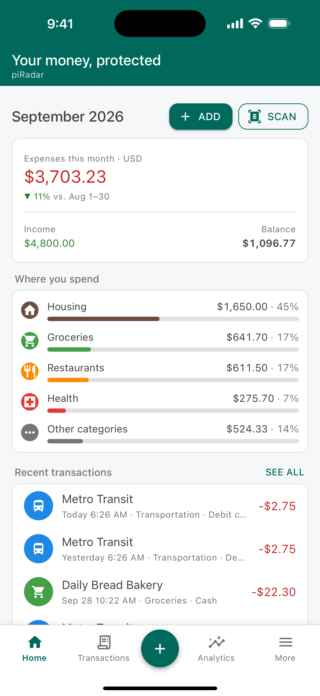
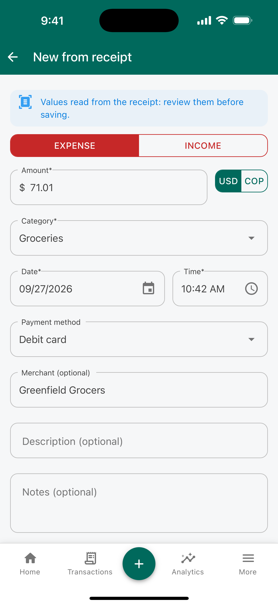
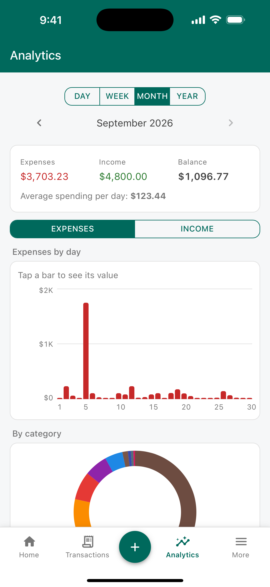
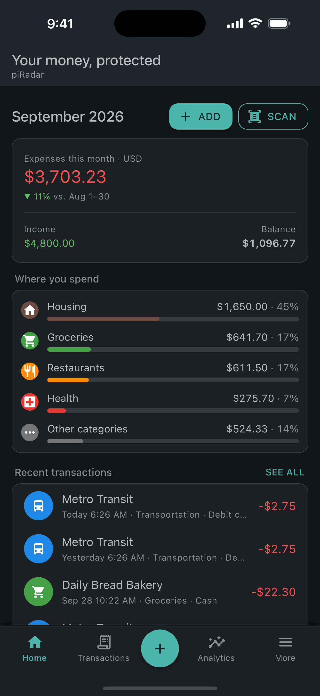

# piRadar

[](https://dotnet.microsoft.com/)
[](https://learn.microsoft.com/dotnet/maui/)
[](https://learn.microsoft.com/dotnet/csharp/)
[](https://developer.android.com/)
[](https://developer.apple.com/ios/)
[](https://mudblazor.com/)
[](https://www.sqlite.org/)
[](LICENSE)
[](#privacy)

A personal finance app for **Android** and **iPhone**: record expenses and income (by hand or from receipt photos read with on-device OCR), organize them by category and payment method, and analyze them by day, week, month or year in **COP** and **USD**. Everything stays on the device; there is no cloud. The interface is available in Spanish and in English (US).

- **App Store**: [piRadar on the App Store](https://apps.apple.com/app/id6817079629)
- **Google Play**: [piRadar on Google Play](https://play.google.com/store/apps/details?id=com.jhbelalc.piradar)
- **Help**: [English](https://www.belvicto.com/piRadar/help.html) · [Español](https://www.belvicto.com/piRadar/ayuda.html)
- **Privacy policy**: [English](https://www.belvicto.com/piRadar/privacy-policy.en.html) · [Español](https://www.belvicto.com/piRadar/politica-privacidad.html)

<p>
  
  
  
  
</p>

## Features

- Expenses and income with categories, subcategories, icons and colors, and configurable payment methods.
- **Receipt scanning**: take a photo or pick one from the gallery. The text is read on the device (ML Kit on Android, Apple Vision on iOS) and the app *proposes* the total, date, merchant and tax ID. You always confirm before saving.
- Analysis by day, week, month and year, with charts by category, payment method and over time, and a daily average.
- Separate totals per currency, plus an optional consolidated view in your base currency using exchange rates you enter yourself.
- Opening balance carried over between periods.
- **Search** across the whole history by keyword (merchant, notes, category, payment method or amount) and by category, ignoring case and accents.
- Full-screen receipt photo viewer with pinch, drag and double-tap zoom.
- Encrypted, password-protected backup file (`.piradar`) that can be restored on another device, including across Android and iOS.
- Light, dark or system theme.

## Privacy

- The database is SQLite encrypted in SQLCipher-compatible mode. Its key is generated on first launch and stored in the platform secure storage (Keychain / Keystore).
- Receipt images are stored as BLOBs inside the encrypted database, never as loose files.
- The system backup is disabled on purpose; the only supported backup is the app's own encrypted export/import.
- No accounts, no ads, no tracking. The release Android build ships without the `INTERNET` permission.

## Tech stack

| Area | Choice |
|---|---|
| Framework | .NET 10, .NET MAUI Blazor Hybrid, C# |
| Targets | `net10.0-android`, `net10.0-ios26.0` (no Mac Catalyst or Windows) |
| UI | MudBlazor 9 (donut chart with `MudChart`, bars with its own `BarChart` component) |
| Database | `sqlite-net-base` + `SQLitePCLRaw.bundle_e_sqlite3mc` (SQLCipher mode) |
| OCR | `Plugin.Maui.OCR` behind `IOcrService` |
| Tests | xunit.v3 on Microsoft.Testing.Platform |

## Project layout

```
PiRadar.slnx
src/
  PiRadar.Core/   domain, Money, receipt parser, analytics, backup crypto (net10.0, no MAUI)
  PiRadar.Data/   sqlite-net records, repositories, migrations, seeds, backup export/import
  PiRadar.App/    MAUI Blazor Hybrid UI, DI and platform services (OCR, camera, secure storage)
tests/
  PiRadar.Core.Tests/
  PiRadar.Data.Tests/
tools/            build scripts for APK, AAB and IPA, App Store Connect helper, OCR fixtures guide
store/            store listings, privacy policies and screenshots
```

All testable logic lives in `PiRadar.Core`; the app project only holds UI and platform code.

## Requirements

- .NET SDK 10.0.401 with the `maui` workload (`dotnet workload install maui`).
- For iOS: a Mac with Xcode (the project builds with `ValidateXcodeVersion` disabled).
- For Android: the Android SDK and an emulator or a device.

## Build and run

```sh
dotnet build src/PiRadar.App -f net10.0-android              # build for Android
dotnet build src/PiRadar.App -f net10.0-android -t:Install   # build and install on an emulator or device
dotnet build src/PiRadar.App -f net10.0-ios26.0              # build for iOS (simulator)

dotnet test                                                  # all tests (plain net10.0, no MAUI)
dotnet test --project tests/PiRadar.Core.Tests               # a single test project
```

Release builds (signed APK, AAB for Google Play, IPA for the App Store) are produced with the scripts in `tools/`: `build-apk.sh`, `build-aab.sh` and `build-ipa.sh`. They need the signing keys, which are kept outside this repository.

## License

The source code is available under the [PolyForm Noncommercial License 1.0.0](LICENSE) (SPDX: `PolyForm-Noncommercial-1.0.0`): you may read, study, modify and share it for noncommercial purposes, keeping the `Required Notice` line. Commercial use requires permission from the copyright holder. This is a source-available license, not an OSI open-source license, so GitHub lists it as "Other". The name "piRadar", its icon and the store listing assets (`store/`) are not covered by this license. Third-party dependencies keep their own licenses.

## Feedback and contributing

Bug reports and suggestions are welcome as [GitHub issues](https://github.com/jhbelalc/piRadar/issues) or by email to belvictodeveloper@gmail.com. Please do not include real receipts, account numbers or other personal data in issues; receipt test fixtures in this repository are anonymized.

Working conventions (naming, money as `long` minor units, UTC timestamps, migrations, localization through `Pick("español", "English")`) are documented in [`CLAUDE.md`](CLAUDE.md).
